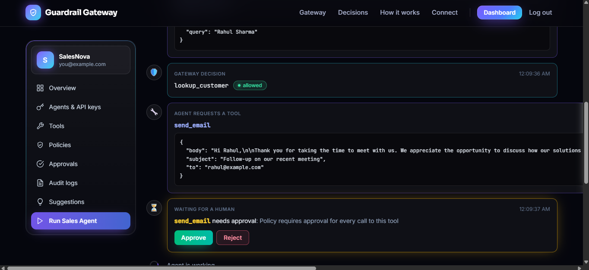
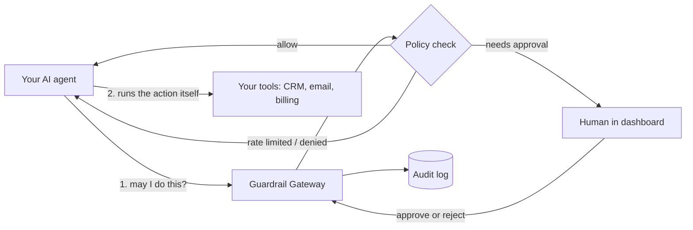

# 🛡️ Guardrail Gateway

**A security guard between your AI agents and the tools they use.**

AI agents can send emails, edit customer records and create quotes. Guardrail Gateway makes sure they
ask first. Before an agent acts, the gateway decides:

| Decision | Meaning |
|---|---|
| ✅ Allow | Safe actions run straight away |
| ⏱ Rate limit | Too many calls are slowed down |
| 🙋 Ask a human | Risky actions wait for a person to approve |
| ⛔ Deny | Dangerous actions are blocked |

Every decision is saved in an audit log.

**[▶ Try the live demo](https://guardrail-gateway-five.vercel.app)** (no sign-up)



## Why it is different

- **AI sets the rules.** When an agent uses a new action, an AI reviews it and picks the risk, rate limit,
  approval rule or deny. Nothing to configure by hand. A person can change any rule.
- **No changes inside your agent.** Add an API key, the gateway URL and one `guard(...)` line.
- **A Policy Advisor agent** reads your approval history and suggests better rules. A human clicks Apply.
- **A one-click demo** with a real AI sales agent.

## How it works



The gateway never sees your tools. The agent asks, the gateway answers, and the agent runs the action
itself only if it was allowed.

## Connect your agent

1. Register your company in the dashboard and create an agent. Copy the API key (shown once).
2. Add two settings to your app:
   ```
   GUARDRAIL_URL=https://your-gateway-url
   GUARDRAIL_API_KEY=gk_live_...
   ```
3. Wrap the risky action:
   ```js
   import { guard } from "@/lib/guardrail";

   const ticket = await guard(
     "create_ticket",
     { issue, priority },        // keep this small, it is saved in the audit log
     () => actionAgent(data)     // your own code, unchanged
   );
   ```
   Copy `sdk/js/guardrail.js` into your project to get `guard`.

## Tech stack

Next.js (TypeScript) · FastAPI (Python) · MongoDB Atlas · Redis · LangGraph · Groq

## Project layout

```
backend/       Gateway and platform API (FastAPI)
frontend/      Dashboard (Next.js)
sales-agent/   Demo agent (LangGraph) and fake CRM / email tools
```

## Run it locally

You need Node 20+, Python 3.12+, a free MongoDB Atlas cluster, a Redis database (Redis Cloud has a free
plan) and a Groq API key.

```bash
# 1. Gateway (port 8000)
cd backend
python -m venv .venv
source .venv/bin/activate          # Windows: .venv\Scripts\Activate.ps1
pip install -r requirements.txt
cp .env.example .env               # then fill in the values
python -m uvicorn app.main:app --reload --port 8000

# 2. Dashboard (port 3000)
cd frontend
cp .env.example .env.local
npm install
npm run dev

# 3. Demo Sales Agent (port 8001)
cd sales-agent
python -m venv .venv && source .venv/bin/activate
pip install -r requirements.txt
cp .env.example .env
python -m uvicorn app.main:app --port 8001
```

Then open http://localhost:3000, register a company, create an agent named "Sales Agent", put its key in
`sales-agent/.env` as `GATEWAY_API_KEY`, and restart the sales agent.

Use `localhost`, not `127.0.0.1`, or the login cookie will not work.

## Safety design

- If Redis is down, the gateway **blocks** the action instead of allowing it.
- API keys are stored as hashes and shown once.
- The AI sees only the action name, description and field **names**, never the data values.
- If the AI fails, new actions fall back to "ask a human", never to "allow".
- The Policy Advisor only suggests. It never relaxes high-risk actions.
- Audit logs are read-only.

## Known limitations

- The AI's rule choices are a guess and can vary. Check the Policies page.
- Demo runs are kept in memory and reset when the service restarts.
- Free hosting sleeps after inactivity, so the first demo load can take a minute.

## Contributing

Contributions are welcome. See [CONTRIBUTING.md](CONTRIBUTING.md) and the
[good first issues](../../issues?q=is%3Aopen+label%3A%22good+first+issue%22).

## License

MIT, see [LICENSE](LICENSE).
